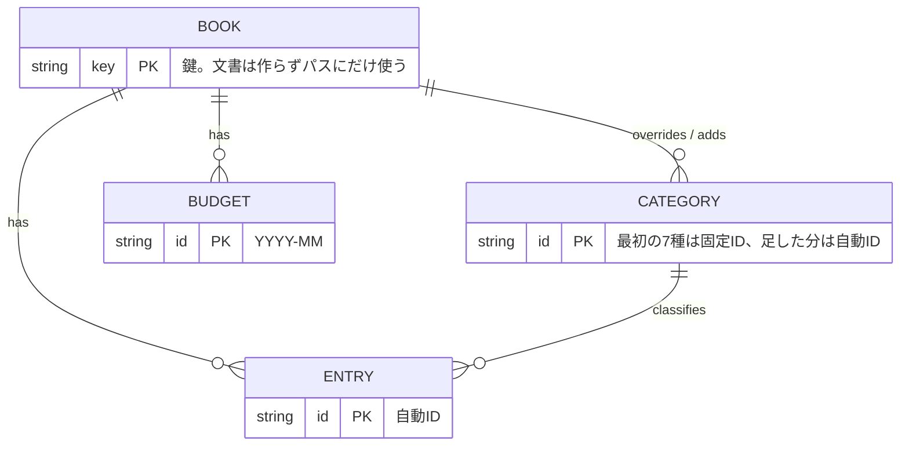

# 設計メモ

2人（同棲中のカップル）で、共通のお財布（共通口座）から出た支出を記録して見る PWA。

## 結論

- 作りは「かいもの」（`~/dev/kaimono`）と同じ。画面は GitHub Pages（Vite + React + TypeScript）、共有の保存先は家計簿専用の Firebase Firestore（プロジェクト `kakeibo-c2f4e1`、東京 `asia-northeast1`、無料枠）。
- ログインは無い。家計簿は `books/{鍵}/…` に置き、鍵（128bit 乱数の16進32桁）を知っている人だけが読み書きできる。`firestore.rules` は鍵の SHA-256 だけを持ち、リポに鍵は載らない。鍵の本体はこの Mac の `.secret-key`（git 管理外）。
- 鍵はリンク `https://iiiitiiitiiti.github.io/kakeibo/#k=<鍵>` で渡す。鍵は URL のハッシュに残し、マニフェストは置かない（理由はかいものの docs/decisions/001 と同じ。iPhone のホーム画面から開いたときに鍵が落ちないようにする）。
- 開くと最初は記録画面。「今月」タブで予算に対する残り・カテゴリ別の合計・その月の記録を見る。

## 本人が決めたこと（2026-11-22）

- 記録するのは共通のお財布の支出。個人の（相手に見せない）収入・支出は「いつかあればいい。今はなくてよい」。
- Discord の kakeibo-bot・GAS の閲覧ページとはつながない。別のアプリとして作る。
- カテゴリは最初に7種。2人が画面から足す・名前を変える・並べ替える・隠すことができる。
- 開いたときの最初の画面は記録画面。今月の残りは別の画面でよい。
- 保存先は家計簿専用の Firebase を新しく作る（かいものと相乗りすると rules が1つのファイルに同居し、直すときに片方を壊しうるため）。
- 共有はかいものと同じリンク方式。リンクが漏れると家計簿を見られ書き換えられることは説明済みで、承知のうえで選んだ。

## なぜこの形か

| 案 | 採らなかった理由 |
|---|---|
| Artifact の db | 相手にも Claude のアカウントと招待が要る |
| かいものの Firebase に相乗り | rules が1ファイルに同居し、片方を直すともう片方を壊しうる |
| Google ログイン | 守る強さは上がるが、相手の Google アカウントと設定の手間が増える。本人がリンク方式を選んだ |
| 鍵つきリンク・専用 Firebase（採用） | 実績のある型。相手はリンクを開くだけ |

## データ

- ENTRY: 金額（1〜9,999,999 の整数円）・categoryId・日付（端末のローカル日付 `YYYY-MM-DD`。toISOString は世界時なので朝9時前が前日になる）・メモ（40字まで）・書いた人・書いた時刻・直した時刻。
- CATEGORY: 名前（12字まで）・並び順・隠すか。最初の7種（`src/model.ts` の `DEFAULT_CATEGORIES`）はコードに持ち、保存先には2人が変えた分だけを同じ ID の文書で置く。最初に保存先へ書き込む方式は、2台目の初回起動で1台目の変更を元に戻すので採らない。消さずに隠す（rules も delete を拒否）。見つからない ID の記録は「その他」として出す。全部は隠せない。
- BUDGET: `budgets/{YYYY-MM}` に `{amount}`。その月の予算は「その月か、それより前で一番新しい月の値」。予算を変えると今月から先に効き、過去の月は変わらない。0 は「決めていない」。map 1つにまとめないのは、rules で中身を検査できないため。
- 書いた人の呼び名は端末ごとに localStorage（`kakeibo:me`）。鍵も `kakeibo:key`。かいものと同じ github.io の上で動くので、名前を分けないと互いの鍵を上書きする。

## 決めたこと

- 金額は自前の数字キーで打つ。iPhone のキーボードを出さないので、ページがずれる問題（かいもので重ねた対策）を避けられる。キーは指が触れた瞬間（pointerdown）に打ち、`touch-action: manipulation` で連打の拡大を防ぐ。
- 記録は「金額→カテゴリ→記録する」の3操作。日付（既定は今日）とメモは任意。
- 記録の直後と消した直後に、6秒の取り消しを出す。お知らせは画面の下に出す（上だと次に打つ金額が隠れる）。
- 「つながりません」の帯も画面の下に重ねる（途中で出たときに画面がずれて押し間違えたため）。
- カテゴリの色は ID から決める（足したり並べ替えたりしてもほかの色が変わらない）。
- 書き込みは待たずに画面へ出す（Firestore の端末内キャッシュ）。保存先に断られたときだけ知らせる。
- 「今月」にカレンダーを置く（2026-11-22 ユーザー依頼）。各日に合計を短く出し（1万以上は「1.2万」）、日を押すとその日の記録だけに絞る。もう一度押すか「月の全部を見る」で戻す。月を変えたら絞り込みを外す。並びは 予算と残り → カレンダー → 記録 → カテゴリ別。
- 表示は明るい色だけ（かいものと同じ）。
- `index.html` の CSP が `style-src 'self'` なので、`npm run dev` では見た目が付かない。画面の確認は `npm run build` のあと `npm run preview` で行う。

## やらないこと（今は）

- 個人の（相手に見せない）収入・支出。やるなら「自分だけの鍵」で別の帳簿を持つ形にできる。
- 収入の記録・立て替えの精算・推移のグラフ・書き出し・Discord bot との連携・レシート読み取り。

## 鍵を作り直すとき

1. 新しい鍵を作る: `openssl rand -hex 16 | tr -d '\n' > .secret-key`
2. `firestore.rules` の `isOurBook` のハッシュを `printf %s "$(cat .secret-key)" | shasum -a 256` の値に変える
3. `npx firebase-tools deploy --only firestore:rules`
4. 2人に新しいリンクを送る（古い鍵の記録は読めなくなるので、移すなら先に写す）
