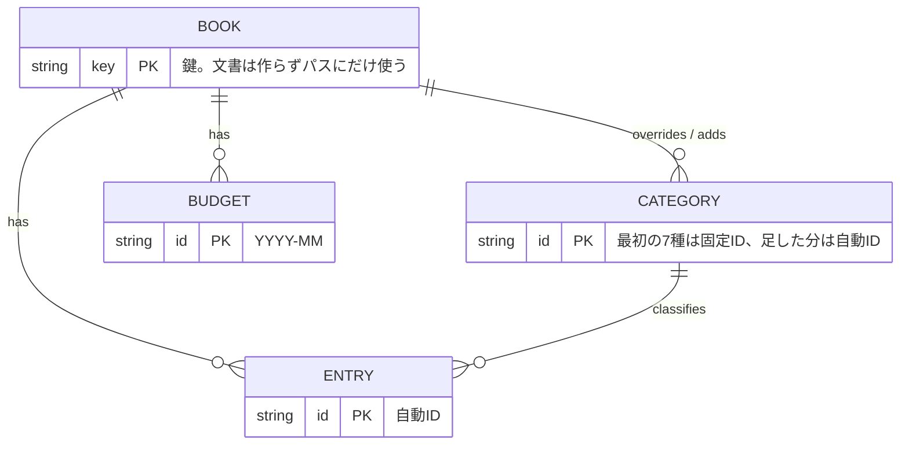

# 設計メモ

2人（同棲中のカップル）で、共通のお財布（共通口座）から出た支出を記録して見る PWA。

## 結論

- 作りは「かいもの」（`~/dev/kaimono`）と同じ。画面は GitHub Pages（Vite + React + TypeScript）、共有の保存先は家計簿専用の Firebase Firestore（プロジェクト `kakeibo-c2f4e1`、東京 `asia-northeast1`、無料枠）。
- ログインは無い。家計簿は `books/{鍵}/…` に置き、鍵（128bit 乱数の16進32桁）を知っている人だけが読み書きできる。`firestore.rules` は鍵の SHA-256 だけを持ち、リポに鍵は載らない。鍵の本体はこの Mac の `.secret-key`（git 管理外）。
- 鍵はリンク `https://iiiitiiitiiti.github.io/kakeibo/#k=<鍵>` で渡す。鍵は URL のハッシュに残し、マニフェストは置かない（理由はかいものの docs/decisions/001 と同じ。iPhone のホーム画面から開いたときに鍵が落ちないようにする）。
- 開くと最初は記録画面。「今月」タブで予算に対する残り・カテゴリ別の合計・その月の記録を見る。

## 本人が決めたこと（2026-11-22）

- 記録するのは共通のお財布の支出。個人の（相手に見せない）収入・支出は「いつかあればいい。今はなくてよい」。
- Discord の kakeibo-bot・GAS の閲覧ページとはつながない。別のアプリとして作る。
- カテゴリは最初に7種。2人が画面から足す・名前を変える・並べ替える・隠すことができる。
- 開いたときの最初の画面は記録画面。今月の残りは別の画面でよい。
- 保存先は家計簿専用の Firebase を新しく作る（かいものと相乗りすると rules が1つのファイルに同居し、直すときに片方を壊しうるため）。
- 共有はかいものと同じリンク方式。リンクが漏れると家計簿を見られ書き換えられることは説明済みで、承知のうえで選んだ。

## なぜこの形か

| 案 | 採らなかった理由 |
|---|---|
| Artifact の db | 相手にも Claude のアカウントと招待が要る |
| かいものの Firebase に相乗り | rules が1ファイルに同居し、片方を直すともう片方を壊しうる |
| Google ログイン | 守る強さは上がるが、相手の Google アカウントと設定の手間が増える。本人がリンク方式を選んだ |
| 鍵つきリンク・専用 Firebase（採用） | 実績のある型。相手はリンクを開くだけ |

## データ

- ENTRY: 金額（1〜9,999,999 の整数円）・categoryId・日付（端末のローカル日付 `YYYY-MM-DD`。toISOString は世界時なので朝9時前が前日になる）・メモ（40字まで）・書いた人・書いた時刻・直した時刻。
- CATEGORY: 名前（12字まで）・並び順・隠すか。最初の7種（`src/model.ts` の `DEFAULT_CATEGORIES`）はコードに持ち、保存先には2人が変えた分だけを同じ ID の文書で置く。最初に保存先へ書き込む方式は、2台目の初回起動で1台目の変更を元に戻すので採らない。消さずに隠す（rules も delete を拒否）。見つからない ID の記録は「その他」として出す。全部は隠せない。
- BUDGET: `budgets/{YYYY-MM}` に `{amount}`。その月の予算は「その月か、それより前で一番新しい月の値」。予算を変えると今月から先に効き、過去の月は変わらない。0 は「決めていない」。map 1つにまとめないのは、rules で中身を検査できないため。
- 書いた人の呼び名は端末ごとに localStorage（`kakeibo:me`）。鍵も `kakeibo:key`。かいものと同じ github.io の上で動くので、名前を分けないと互いの鍵を上書きする。

## 決めたこと

- 金額は自前の電卓で打つ（2026-11-22 ユーザー依頼で数字キーから電卓にした）。＋−×÷・＝・C・1文字消すがあり、掛け算と割り算を先に計算して円未満は四捨五入する。式の途中でも答えを金額として出し、最後の記号は無視する。数の頭の0は付けないので、0だけの数（0で割る式）は打てない。
- 自前のキーにした理由: iPhone のキーボードを出さないので、ページがずれる問題（かいもので重ねた対策）を避けられる。キーは指が触れた瞬間（pointerdown）に打ち、`touch-action: manipulation` で連打の拡大を防ぐ。
- 記録は「金額→カテゴリ→記録する」の3操作。日付とメモは任意。
- 記録画面の並びは 金額 → カテゴリ｜日付（横並び）→ メモ → 電卓 → 記録する（2026-11-22 ユーザー依頼）。カテゴリが余った幅を取り、日付は中身の幅。幅 360px 未満では日付を「11/22(日)」に縮める。
- 日付は「今日」「昨日」と言わず「11月22日(日)」で出す（2026-11-22 ユーザー依頼）。一覧も同じ。
- 日付は自分で選んだ値だけを持ち、選んでいなければ今日に付いていく。開いたまま日をまたいだときに、前の日付のまま記録してしまうのを防ぐため。選んだ日付は記録したあとも残す（2026-11-22 ユーザー依頼。過去のレシートを続けて入れるため）。ただし選んだ日付が有効なのはその日のうちだけで、日が変わったら今日に戻す（iPhone はアプリを何日もメモリに残すので、前に選んだ日付のまま記録してしまうのを防ぐ）。先の日付は受け取らない。今日でない日付のときは日付欄に色を付けて気づけるようにする。
- 「カテゴリを足す・直す」はプルダウンの最後の選択肢に置く。横に＋ボタンを置くと、カテゴリと日付を横並びにしたときにカテゴリ名の幅が足りなくなるため。
- メモ欄は、選んだカテゴリで前に書いたメモを候補に出す（端末の入力候補として出るだけで、画面は増やさない）。
- 記録した直後のお知らせの2行目に「今月の残り」を出す。最初の画面は記録画面のままにしつつ、使った瞬間に残りが分かるようにするため。予算があり、今月の記録を読み終えていて、今月の日付の記録のときだけ出す。
- カテゴリはプルダウン（端末の選択画面）で選ぶ（2026-11-22 ユーザー依頼で、ボタンの並びから変えた）。記録画面・直す画面とも同じ。記録したら未選択に戻し、前のカテゴリのまま記録してしまうのを防ぐ。
- 記録の直後と消した直後に、6秒の取り消しを出す。お知らせは上の帯に重ねて出す。最初は下に出していたが、電卓のキーと「記録する」に重なり、続けて記録するときに邪魔になった。金額の表示にはかからない高さ（上の帯の中）に収め、長い文は1行に切り詰める。
- 「つながりません」の帯も同じ場所に重ねる（途中で出たときに画面がずれないように。押す操作は下へ通す）。
- カテゴリの色は ID から決める（足したり並べ替えたりしてもほかの色が変わらない）。
- 書き込みは待たずに画面へ出す（Firestore の端末内キャッシュ）。保存先に断られたときだけ知らせる。
- 「今月」にカレンダーを置く（2026-11-22 ユーザー依頼）。各日に合計を短く出し（1万以上は「1.2万」）、日を押すとその日の記録だけに絞る。もう一度押すか「月の全部を見る」で戻す。月を変えたら絞り込みを外す。並びは 予算と残り → カテゴリ別 → カレンダー → 記録（カテゴリ別は最初は一番下だったが、2026-11-22 のユーザー依頼で合計のすぐ下へ移した）。カテゴリ別は記録が届く前から畳んだ場所を置いておき、届いたら高さをなめらかに開く。届いた瞬間にカレンダーが下へ飛ばないようにするため。
- ホーム画面用のアイコン（`public/apple-touch-icon.png`）は角を丸めず端まで青で塗る。iPhone が自分で角を丸めるので、画像の側で丸めると四隅に白が残る（2026-11-22 に指摘を受けて描き直した）。
- カレンダーで日を選ぶと「この日に記録する」が出る（2026-11-22 ユーザー依頼）。押すと記録画面がその日付で開く。先の日には出さない。上の「記録」から開き直したときは今日で始める（記録画面は開くたびに入力を新しくする作りで、日付だけ残すと前に選んだ日のまま記録しやすいため）。
- 「今月」の残りの下に「月末までN日・1日あたり ¥X」を出す（残り ÷ 今日を含む残り日数、切り捨て）。月初に家賃などをまとめて払うので「日割りの進み具合」との比較は出さない（進みすぎに見えてしまう）。
- カテゴリ別の行を押すと、そのカテゴリの記録がその場で開く（取り出す手段。もう一度押すと閉じる）。記録の一覧をカテゴリで絞る案は採らなかった。一覧はカレンダーの下にあり、押しても結果が画面の外で変わるため。
- 相手が書いた記録が開いている間に届いたら、行に少しの間だけ色を付ける。開いた直後にまとめて届く分は数えない。1件消えて一覧に繰り上がってきた古い記録も数えない（書いた時刻が、数え始めより後のものだけ）。
- 保存先にまだ届いていない記録には「送信待ち」を付ける。すぐ届いたときにちらつかないよう、2秒たってから見せる。
- 表示は明るい色が既定で、端末の暗い表示には合わせない。メニューの「画面の色」で明るい・暗いを切り替えられ、選んだ方を端末に覚える（`kakeibo:theme`。本人の決まり: 白が既定・自動では追従しない・手動で切り替えて保存）。最初は「明るい色だけ」だったのを 2026-11-22 に変えた。
  - 暗い表示を選んだ人に一瞬明るい画面を見せないよう、`public/theme.js` を `<head>` で先に動かして色を当てる（CSP が `script-src 'self'` なので、HTML に直接は書けない）。ビルド時に「module でないので束ねられない」と警告が出るが、そのまま置かれるのが狙いどおり。
  - 未確認: iPhone のホーム画面から開いたとき、一番上の時計の帯の色は端末の設定に従う。暗い表示を選ぶと、そこだけ明るく残るかもしれない。
- 動きは端末の「視差効果を減らす」に関係なく常に出す（本人の決まり）。閉じる・消えるときも、出てきた向きへ戻す動きを付ける（下から出る画面・お知らせ）。画面と月の切り替えは進んだ向きから入る。カテゴリ別の開閉は高さをなめらかに変える。
- 下から出る画面を閉じたら、開く前に押していた場所へフォーカスを戻す（メニュー → 予算のように続けて開いたときも、最初に押した場所へ）。
- 電卓のキーの高さは画面の高さから決める（`.keypad` の `--rest` がキー以外の高さ）。小さい iPhone でも「記録する」まで1画面に収めるため。余白や行間は詰めない。
- パソコンではキーボードの数字と ＋−＊／・＝・BackSpace・Esc でも電卓を打てる。幅 900px 以上は2列（記録画面は左に入力・右に最近の記録、今月は左に残り・カテゴリ別・カレンダー、右に記録）。
- CSS の値（色・余白・角の丸み・文字の大きさ・動きの長さ）は `src/styles.css` の先頭の変数にまとめる。余白は 8 の倍数が基本で、4 と 12 だけ例外（本人の決まり）。
- 画面のどこかで失敗しても真っ白にせず、「開き直す」ボタンを出す。
- `index.html` の CSP が `style-src 'self'` なので、`npm run dev` では見た目が付かない。画面の確認は `npm run build` のあと `npm run preview` で行う。

## 確かめ方

- `tests/model.test.ts` は計算（日付・予算・電卓・集計）。`tests/app.test.tsx` は画面の流れ（記録する・残りの知らせ・日付が残る・届いた記録・今月）。`useBook` を差し替えるので、保存先にはつながない。
- 2人が使っている本物の家計簿に試しの記録を書かない。書き込みを伴う確認は自動テストで行う（Mac に Java が無く、Firestore のエミュレータは動かせない）。
- 手元の画面確認は `npm run build` → `npm run preview`。前の版が残るので、読み込み直す前に Service Worker の登録とキャッシュを消す。
- 最初からあるカテゴリの名前をコードで変えても、保存先に同じ ID の文書があればそちらが勝つ（並べ替えや名前の変更をした時点の名前が保存される）。

## やらないこと（今は）

- 個人の（相手に見せない）収入・支出。やるなら「自分だけの鍵」で別の帳簿を持つ形にできる。
- 収入の記録・立て替えの精算・推移のグラフ・書き出し・Discord bot との連携・レシート読み取り。

## 鍵を作り直すとき

1. 新しい鍵を作る: `openssl rand -hex 16 | tr -d '\n' > .secret-key`
2. `firestore.rules` の `isOurBook` のハッシュを `printf %s "$(cat .secret-key)" | shasum -a 256` の値に変える
3. `npx firebase-tools deploy --only firestore:rules`
4. 2人に新しいリンクを送る（古い鍵の記録は読めなくなるので、移すなら先に写す）
